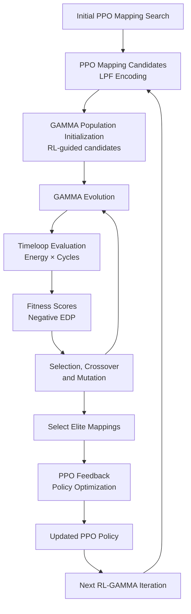

# RL-GAMMA: Reinforcement Learning Guided Genetic Search for DNN Mapping

This repository explores the combination of **Proximal Policy Optimization (PPO)** and **GAMMA**, a genetic algorithm-based mapper, for mapping Deep Neural Networks (DNNs) onto hardware accelerators.

The project builds on reinforcement-learning-based mapping search and GAMMA's evolutionary design-space exploration, using **Timeloop** as the hardware cost model.

The central research question is:

> Can reinforcement-learning-guided initialization and feedback improve genetic algorithm-based DNN mapping search compared with using either approach independently?

The repository implements and evaluates three approaches:

1. **RL-only:** PPO generates candidate mappings.
2. **GAMMA-only:** GAMMA independently explores the mapping space using its native genetic algorithm.
3. **RL + GAMMA:** PPO-generated mappings initialize GAMMA's population, and high-quality GAMMA solutions are fed back into PPO to guide subsequent searches.

The objective is to compare mapping quality, search efficiency, and runtime across different workload characteristics and random seeds.

---

## 1. Research Overview

DNN mapping onto hardware accelerators involves assigning computation and data movement across the available hardware resources. The mapping search space is large, and finding efficient mappings is computationally challenging.

This project investigates combining two complementary search strategies:

- **Reinforcement Learning:** PPO learns to generate mapping candidates through interaction with the Timeloop evaluation environment.
- **Genetic Algorithm:** GAMMA evolves candidate mappings through population-based search, selection, crossover, and mutation.
- **Hardware Cost Evaluation:** Timeloop evaluates mappings to estimate energy consumption and execution cycles.

The hybrid approach uses PPO to guide GAMMA's initial search and subsequently incorporates promising GAMMA solutions into PPO's learning process.

## 2. Hybrid RL-GAMMA Architecture

The hybrid algorithm follows this iterative workflow:



### Hybrid algorithm

The current implementation performs the following steps:

1. Train PPO to generate an initial set of mapping candidates.
2. Convert PPO-generated LPF mappings into GAMMA-compatible individuals.
3. Use these individuals to initialize GAMMA's population.
4. Run GAMMA's evolutionary search and evaluate candidate mappings using Timeloop.
5. Select the best GAMMA mappings.
6. Feed selected mappings back into PPO through continued training and feedback optimization.
7. Repeat the process using the updated PPO policy and promising mappings from previous iterations.

The current default configuration uses:

| Parameter | Default |
|---|---:|
| Initial PPO episodes | 30 |
| GAMMA population | 20 |
| GAMMA generations per iteration | 5 |
| GAMMA elites | 5 |
| RL-GAMMA iterations | 3 |
| PPO feedback steps | 4 |
| Continued PPO episodes | 4 |

These parameters can be modified through environment variables.

### Mapping representation

The PPO implementation uses a Loop-Parallel-Factor (LPF) representation.

The PPO-to-GAMMA bridge converts these mappings into GAMMA-compatible individuals. This conversion is not necessarily an exact inverse of the original representation: some spatial mapping information may be represented temporally when it cannot be expressed directly in GAMMA's chromosome format. GAMMA's mapping validation and repair mechanisms may also modify candidates.

Consequently, the hybrid approach should be understood as RL-guided initialization and feedback through a compatible mapping representation, rather than guaranteed preservation of every PPO mapping.

---

## 3. Experimental Baselines

Three implementations are provided to evaluate the contribution of the hybrid approach.

| Approach | Entry-point script | Initialization |
|---|---|---|
| RL-only | `rl_only_baseline.py` | PPO |
| GAMMA-only | `gamma_lpf_only.py` | GAMMA-native random population |
| RL + GAMMA | `rl_ga_loop_lpf.py` | PPO-generated population |

All three approaches use the same workload definitions and hardware architecture configuration.

### RL-only

PPO generates mapping candidates and evaluates them using Timeloop. No genetic algorithm refinement or GAMMA feedback is performed.

### GAMMA-only

GAMMA starts with its own randomly initialized population and performs evolutionary mapping search without PPO-generated candidates.

### RL + GAMMA

PPO provides the initial candidate population for GAMMA. The best GAMMA solutions are subsequently fed back into PPO, allowing later search iterations to benefit from previous evolutionary results.

---

## 4. Workloads

The experiments use five workload configurations to investigate different characteristics of the DNN mapping space.

All dimensions are specified in Timeloop order:

`[N, K, C, F, P, Q, R, S, T]`

| Workload | N | K | C | F | P | Q | R | S | T |
|---|---:|---:|---:|---:|---:|---:|---:|---:|---:|
| Small | 1 | 16 | 8 | 32 | 32 | 32 | 3 | 3 | 3 |
| Baseline | 1 | 32 | 16 | 120 | 120 | 120 | 3 | 3 | 3 |
| Spatial-heavy | 1 | 32 | 16 | 224 | 224 | 224 | 3 | 3 | 3 |
| Channel-heavy | 1 | 128 | 64 | 56 | 56 | 56 | 3 | 3 | 3 |
| Pointwise | 1 | 64 | 32 | 112 | 112 | 112 | 1 | 1 | 1 |

The workloads are intended to exercise different mapping characteristics:

- **Small:** A smaller problem configuration.
- **Baseline:** The reference workload.
- **Spatial-heavy:** Larger spatial dimensions.
- **Channel-heavy:** Larger input and output channel dimensions.
- **Pointwise:** A workload with 1×1 convolution kernels.

The same hardware architecture is used across these workloads. Only the problem dimensions and corresponding initial PPO factors change.

---

## 5. Evaluation Metrics

The primary optimization objective is Energy-Delay Product (EDP):

$$
EDP = Energy \times Cycles
$$

Where:

- **Energy:** Estimated energy consumption of the mapping.
- **Cycles:** Estimated execution cycles.

Lower EDP indicates a better mapping under this objective.

GAMMA uses negative EDP as its fitness score:

$$
Fitness = -EDP
$$

Therefore, higher GAMMA fitness corresponds to lower EDP.

The experiments also record runtime to assess the computational cost of each search strategy.

The comparison focuses on:

- Best EDP achieved.
- Search runtime.
- Consistency across random seeds.
- Sensitivity to workload characteristics.
- Whether hybrid search provides improvements over either standalone approach.

---

## 6. Repository Structure

```text
timeloop-rl-dnn-mapping/
│
├── Computationally-Efficient-DNN-Mapping/
│   │
│   ├── rl_ga_loop_lpf.py
│   ├── rl_only_baseline.py
│   ├── gamma_lpf_only.py
│   ├── rl_script_fixed.py
│   │
│   └── test_*.py
│
├── gamma-timeloop/              # GAMMA integration (submodule)
│   └── src/
│       ├── gamma_lpf_env.py
│       ├── gamma_lpf_chromosome.py
│       ├── mapping_validation.py
│       └── in_config_3d/
│           ├── arch.yaml
│           ├── problem.yaml
│           └── sparse.yaml
│
├── pytimeloop/                  # PyTimeloop (submodule)
│   └── lib/
│       └── timeloop/            # Timeloop (nested submodule)
│
├── results/                     # Experiment outputs
│
├── README.md
├── SETUP.md
└── .gitmodules
```

The main experiment entry points are:

- `rl_ga_loop_lpf.py`: Hybrid RL-GAMMA experiment.
- `rl_only_baseline.py`: PPO-only baseline.
- `gamma_lpf_only.py`: GAMMA-only baseline.
- `rl_script_fixed.py`: Shared PPO training and feedback implementation.

---

## 7. Installation

Refer to **[SETUP.md](SETUP.md)** for detailed installation instructions.

The setup process includes:

1. Cloning the repository with recursive Git submodules.
2. Installing system dependencies.
3. Building Timeloop with Accelergy support.
4. Installing PyTimeloop.
5. Verifying the Timeloop installation.

The project uses Python 3.10.

---

## 8. Running Experiments

Run the following commands from the repository root with the project Python environment activated.

### RL + GAMMA

```bash
RL_GA_WORKLOAD=baseline \
RL_GA_SEED=1 \
python Computationally-Efficient-DNN-Mapping/rl_ga_loop_lpf.py
```

### RL-only

```bash
RL_GA_WORKLOAD=baseline \
RL_GA_SEED=1 \
python Computationally-Efficient-DNN-Mapping/rl_only_baseline.py
```

### GAMMA-only

```bash
RL_GA_WORKLOAD=baseline \
RL_GA_SEED=1 \
python Computationally-Efficient-DNN-Mapping/gamma_lpf_only.py
```

### Selecting a workload

The following workload names are supported:

- `small`
- `baseline`
- `spatial-heavy`
- `channel-heavy`
- `pointwise`

For example, to run the hybrid approach on the pointwise workload:

```bash
RL_GA_WORKLOAD=pointwise \
RL_GA_SEED=42 \
python Computationally-Efficient-DNN-Mapping/rl_ga_loop_lpf.py
```

### Configuring experiments

The hybrid and GAMMA-only scripts support the following environment variables:

| Environment variable | Default | Description |
|---|---:|---|
| `RL_GA_WORKLOAD` | `baseline` | Workload selection |
| `RL_GA_SEED` | `42` | Experiment random seed |
| `LPF_GAMMA_POP` | `20` | GAMMA population size |
| `LPF_GAMMA_GENS` | `5` | GAMMA generations |
| `LPF_GAMMA_ELITES` | `5` | Number of elite mappings |
| `LPF_ITERATIONS` | `3` | Number of hybrid feedback iterations |
| `LPF_PPO_INITIAL_EPISODES` | `30` | Initial PPO training episodes |
| `LPF_PPO_FEEDBACK_STEPS` | `4` | PPO feedback optimization steps |
| `LPF_PPO_CONTINUED_EPISODES` | `4` | Continued PPO training episodes |

The RL-only baseline additionally supports:

| Environment variable | Default | Description |
|---|---:|---|
| `RL_ONLY_EVAL_BUDGET` | `120` | Requested number of unique candidate evaluations |

Note that the requested RL-only evaluation budget is not necessarily the number of successful Timeloop evaluations. Duplicate candidates and failed evaluations can affect the actual count.

For reproducible comparisons, use the same workload and seed across all three approaches, and record any changes to the default configuration.

---

## 9. Results

Experiment outputs are saved as JSON files under `results/`.

The result files record information such as:

- Workload and random seed.
- Best mapping and corresponding EDP.
- Search configuration.
- Runtime.
- Candidate and evaluation information, where recorded by the experiment.

Results should be compared using consistent workload, seed, and configuration settings.

A single seed or workload is not sufficient to establish that one approach is generally superior. Multiple seeds and workload configurations are needed to assess the consistency and significance of any observed improvement.

---

## 10. Testing

The repository includes tests for the LPF representation, mapping conversion, Timeloop evaluation, and GAMMA integration.

The test scripts are located in:

`Computationally-Efficient-DNN-Mapping/`

Run individual tests from the repository root using Python. Tests that invoke Timeloop require a working Timeloop/PyTimeloop installation.

---

## 11. References

This project builds on the following research:

**1. Computationally Efficient DNN Mapping Search Heuristic using Deep Reinforcement Learning**

Provides the reinforcement-learning-based approach for exploring DNN mapping spaces.

**2. GAMMA: Automating the HW Mapping of DNN Models on Accelerators via Genetic Algorithm**

Sheng-Chun Kao and Tushar Krishna, ICCAD 2020.

**3. Demystifying Map Space Exploration for NPUs**

Sheng-Chun Kao, Angshuman Parashar, Po-An Tsai, and Tushar Krishna, IISWC 2022.

GAMMA source repository: [GAMMA-TimeLoop](https://github.com/maestro-project/gamma)

Timeloop documentation: [https://timeloop.csail.mit.edu/](https://timeloop.csail.mit.edu/)

---

## 12. Research Status

This repository contains the implementation and experimental infrastructure for evaluating RL-only, GAMMA-only, and hybrid RL-GAMMA mapping search.

The central objective is to determine whether RL-guided initialization and feedback improve mapping quality or search efficiency across different workload types and random seeds.

The experimental results should be interpreted as comparative evidence rather than assuming that the hybrid approach is inherently better. In particular, mapping quality must be considered alongside runtime and evaluation cost.